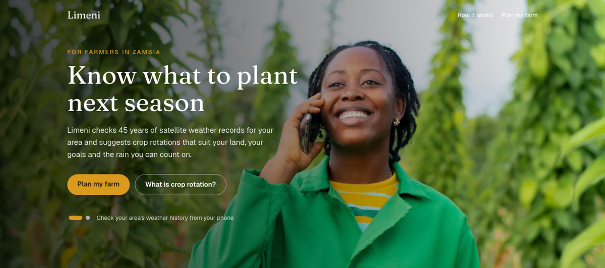
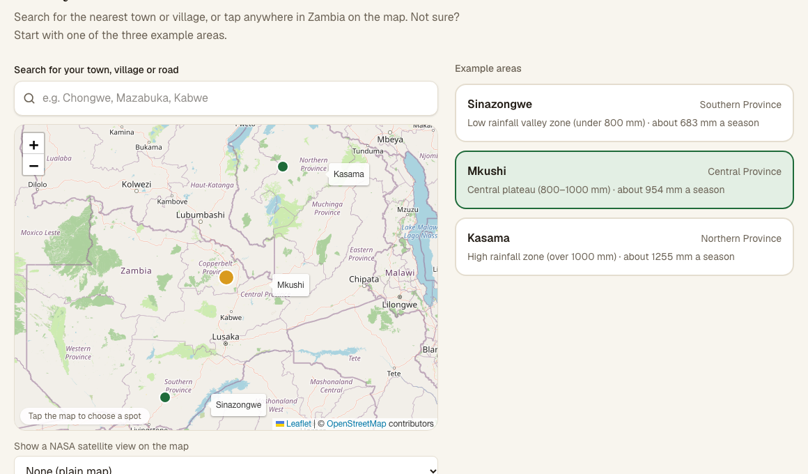
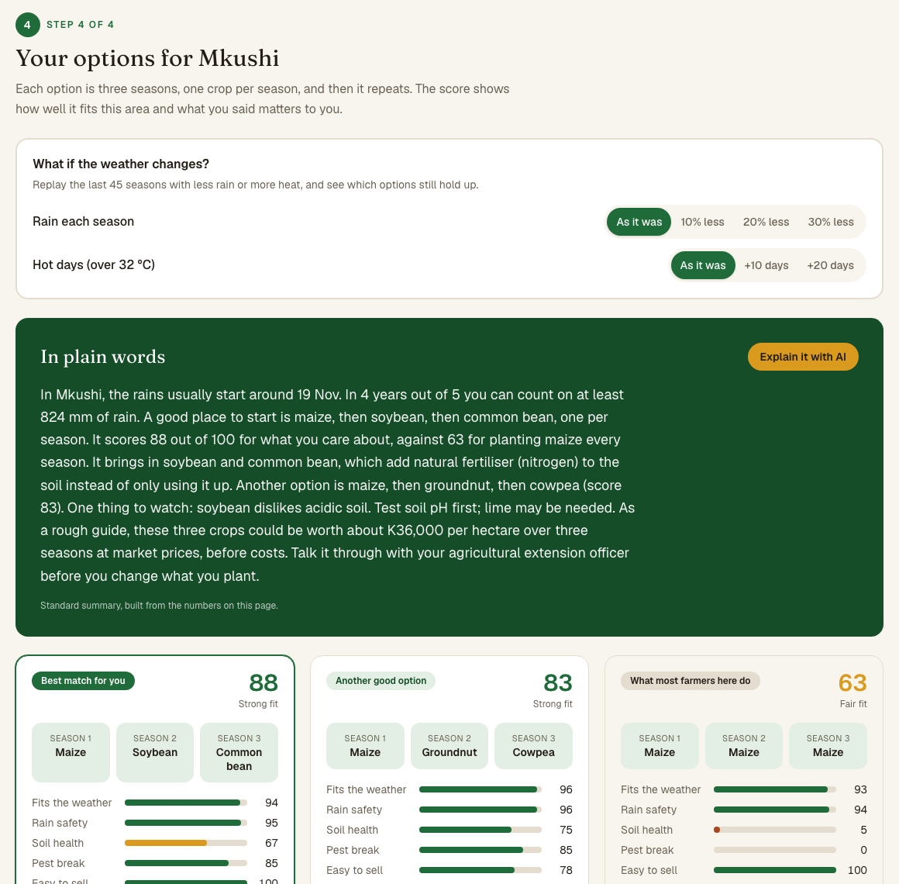
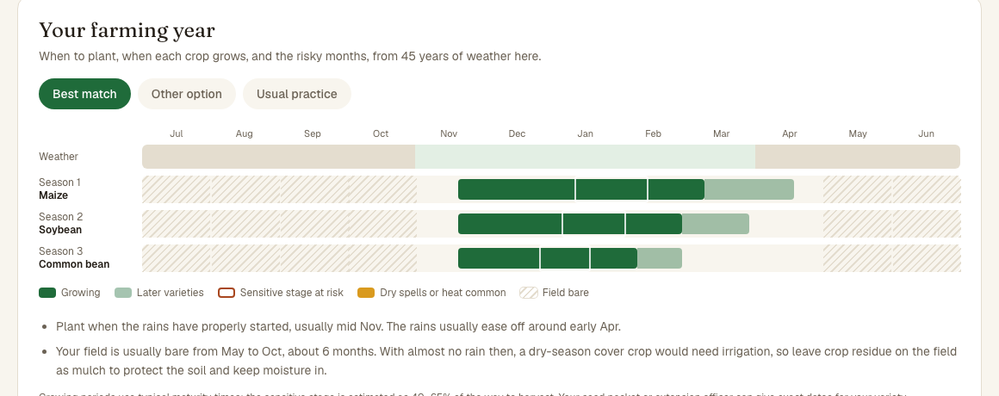

# Limeni

**Crop rotation planning for Zambian farmers, built on 45 years of NASA Earth observations.**

Limeni helps a farmer, often a first-time one, decide what to plant over the next three seasons. It reads the weather history of their own area, checks every crop against it, and compares rotations side by side, explaining each one in plain words.

**Live app:** [limeni.vercel.app](https://limeni.vercel.app)

Built for the [NASA Space Apps Challenge 2026](https://www.spaceappschallenge.org/2026/), challenge **Field Shift: Adapting Farms with NASA Data**.



---

## Why

In the 2023/24 season, drought and long dry spells hit Zambia. Farmers planted 2,233,000 hectares of maize and harvested 981,000: **56% of the maize area was never harvested** (FAO and ZamStats, Integrated Agriculture Survey 2023/24).

Most smallholders plant maize season after season. That drains soil nitrogen, lets pests like fall armyworm build up, and leaves the whole farm exposed when a dry spell hits at flowering. Crop rotation helps, but a farmer needs to know which rotation suits **their** land and weather.

## What it does

Four steps, designed for a phone:

1. **Find your farm.** Search a town, village or road, tap anywhere in Zambia, or start from one of three example areas.
2. **See your weather.** 45 years of records for that spot: when the rains start, the rain you can count on in 4 years out of 5, mid-season dry spells, hot days, soil moisture, trends and land slope.
3. **Tell us about your farm.** Just starting out, or what you grew in the last three seasons (including “nothing, the land rested”), what matters most to you, your soil and your local prices.
4. **Compare your options.** Your current rotation, or the usual practice, against the two best alternatives.



Every option shows:

- **Why this rotation** was suggested
- **The evidence**, as counts from the weather record, e.g. *“Soybean: FAO lists 600–1,500 mm of rain as ideal. This field was in that range in 31 of 45 seasons.”*
- **Good things about it:** nitrogen, deep roots, ground cover, spread risk
- **Risks to check locally**
- **What we don’t know:** the gaps in the data, said plainly
- A **rough value** per hectare, and a **farming calendar** showing when to plant, when each crop is most sensitive, and when the field lies bare



### Features

| Feature | What it does |
|---|---|
| Live weather for any point | Downloads CHIRPS rainfall and NASA POWER data for any spot in Zambia (20 s to 2 min) |
| Place search | Autocomplete for towns, villages and roads in Zambia |
| Exact farm location | Type or paste coordinates (decimal, degrees-minutes-seconds or a Google Maps link) or use the phone's GPS; the map flies to the farm in satellite view, and the pin can be dragged |
| Draw your field | Tap the corners of a field to outline it; Limeni measures its area, saves it on the phone, measures the slope across it, and shows the expected harvest and income for that field |
| Your farm up close | Finds the latest cloud-free NASA HLS (Landsat and Sentinel-2, 30 m) image of the farm, with older images on request |
| “What if” scenarios | Replays 45 seasons with 10–30% less rain or 10–20 more hot days |
| Farming calendar | Planting time, growing period, sensitive stage vs. dry-spell and heat months, bare-field months |
| Soil input | pH (in water or CaCl₂), texture, drainage, organic carbon or fertility |
| Soil report reader | Upload a photo or PDF of a soil test; the values fill in for the farmer to check |
| Your own prices | Current and expected harvest prices per 50 kg bag or per kg, saved on the device |
| Erosion risk | Slope from NASA SRTM; ground-covering crops score higher on sloping land |
| Plain-words summary | An AI summary written only from the numbers on the page, with a fixed fallback text |
| Beginner explainer | What crop rotation is, why it helps, and a live example |
| NASA map layers | MODIS vegetation, SMAP soil moisture and GPM IMERG rainfall through NASA GIBS |



## Data

| Source | What Limeni uses it for |
|---|---|
| **CHIRPS** daily rainfall (UCSB / USGS), via **NASA SERVIR ClimateSERV** | Rain start, rain you can count on, dry spells, droughts, since 1981, ~5 km |
| **NASA POWER** (MERRA-2) | Daily max/min temperature (heat stress) and root-zone soil moisture, ~50 km |
| **NASA SRTM** 30 m elevation, via OpenTopoData | Slope and erosion risk, around a spot or across a drawn field |
| **NASA GIBS**: MODIS NDVI, SMAP, GPM IMERG | Map layers |
| **NASA HLS** (Harmonized Landsat and Sentinel-2, 30 m), via NASA GIBS | A recent cloud-free image of the farm |
| Esri World Imagery | High-resolution satellite base map for finding and outlining fields |
| **FAO ECOCROP** | Each crop’s rainfall, temperature, pH, texture, fertility and drainage needs |
| Zambia Ministry of Agriculture market bulletin | Default crop prices (June–August 2025) |
| Zambia Crop Forecasting Survey 2024/25; FAO / ZamStats IAS 2023/24 | National average yields |
| Zambian variety lists (ISSD Africa 2017; Kagezi Seeds) | Days to maturity |
| Photon (OpenStreetMap) | Place search |

Every value in the crop table is documented with its source in [`src/data/crops.ts`](src/data/crops.ts).

### How we validated the rainfall

Our first version used NASA POWER’s rainfall, which comes from a weather model. It showed the 2023/24 drought as a normal season in the south. We compared three sources for Sinazongwe (a normal season there is 683 mm):

| Source | 2018/19 | 2023/24 | Verdict |
|---|---|---|---|
| NASA POWER (weather model) | 523 mm | 754 mm | Missed 2023/24 |
| GPM IMERG, via POWER | 523 mm | 319 mm | Unexplained drop from 2020 |
| **CHIRPS (satellite + gauges)** | **366 mm** | **488 mm** | **Caught both: chosen** |

We also tested ERA5, which is fast, but it read up to twice as wet as CHIRPS in recent seasons, which would make dry areas look safer than they are.

## How the scoring works

Limeni uses **explainable rules, not a trained model**, so every number can be checked.

1. **Each crop against 45 seasons.** FAO’s EcoCrop rainfall rule (0 below a crop’s minimum, 1 inside its ideal range) is applied to every past season, together with season length, hot days, dry-spell sensitivity, the farmer’s soil (pH, texture, drainage, fertility) and slope.
2. **Each rotation** of three different crops is scored on five things: weather fit, rain safety, soil health (nitrogen, deep roots, ground cover), pest break and ease of selling.
3. **Weighted by the farmer’s priorities** (coping with dry years, healthier soil, easy to sell). Every score keeps the reasons and numbers behind it.

Season numbers (onset, reliable rain, dry spells, droughts) are defined in [`PLAN.md`](PLAN.md#5-season-numbers-already-implemented), and the scoring rules live in [`src/lib/rotation.ts`](src/lib/rotation.ts) and [`src/lib/soil.ts`](src/lib/soil.ts).

## Tech stack

- [Next.js](https://nextjs.org) (App Router) with TypeScript and Tailwind CSS
- [Leaflet](https://leafletjs.com) / React Leaflet for the map, [Recharts](https://recharts.org) for charts
- [DeepSeek](https://www.deepseek.com) (`deepseek-flash`) for the plain-words summary and soil report reading
- [unpdf](https://github.com/unjs/unpdf) for reading text from PDF soil reports
- Hosted on [Vercel](https://vercel.com)

## Project structure

```
src/
  app/
    page.tsx                 Landing page and planner
    api/climate/             Live rainfall and weather for any point (two-step, queue-based)
    api/places/              Place search and reverse lookup
    api/terrain/             Slope and erosion risk from SRTM
    api/soil-report/         Reads a soil test photo or PDF
    api/summary/             Plain-words summary
  components/                Hero, explainer, map, weather story, planner, calendar, panels
  data/
    crops.ts                 Crop table with sources
    locations.ts             The three example areas
    climate/*.json           Saved climate profiles for the example areas
  lib/
    climate.ts               Daily data → season numbers
    rotation.ts              Rotation scoring and explanations
    soil.ts                  Soil suitability rules
    scenario.ts              "What if" scenarios
    calendar.ts              Farming calendar
    terrain.ts               Slope from elevation
    sources.ts               CHIRPS and NASA POWER downloads
    summary.ts               Summary facts and fallback text
scripts/
  build-climate.ts           Re-fetches the example areas' climate data
  check-rotations.ts         Prints recommendations for a quick sanity check
```

## Getting started

Requires Node.js 20 or later.

```bash
npm install
npm run dev
```

Then open [http://localhost:3000](http://localhost:3000).

Other commands:

```bash
npm run build    # production build
npm run lint     # lint
npm run check    # print the recommended rotations for each example area
npm run data     # re-download climate data for the example areas (a few minutes)
```

### Environment variables

| Variable | Needed for | Without it |
|---|---|---|
| `DEEPSEEK_API_KEY` | “Explain it with AI” and the soil report reader | The standard summary is shown, and soil values are entered by hand |

Locally, export it in your shell before `npm run dev`. On Vercel, add it under **Project Settings → Environment Variables**. Never commit it; `.env*` files are ignored by git.

## Deploying

The app deploys to Vercel with no extra configuration:

```bash
npx vercel deploy --prod
```

The live-location, place-search and elevation features use free public services (NASA SERVIR ClimateSERV, Photon, OpenTopoData) with fair-use limits. The three example areas use saved data and always work.

## Limitations

- Weather describes an **area**, not a single field: about 5 km for rainfall, about 50 km for temperature.
- Crop needs are FAO’s general figures, not specific to a seed variety. Drought tolerance, ground cover and ease-of-selling ratings are our own judgement.
- Default prices are national market averages from mid-2025, higher than farm-gate prices; farmers can enter their own.
- The tool has not yet been tested with farmers or extension officers.
- It covers 11 rain-fed field crops. Vegetables, which in Zambia are mostly grown with irrigation in the dry season, are not included yet.

Limeni supports, and doesn’t replace, the judgement of farmers and agricultural extension officers. Every option says so.

## Roadmap

- Check the scoring rules against real harvests, using open historical yield data (maize and soybean, 1981–2016) to set the score weights
- Sessions with farmers and extension officers
- Dry-season vegetable gardens, with frost risk from NASA POWER
- Summaries in Bemba and Nyanja

## Credits

- Data: NASA POWER, NASA SRTM, NASA GIBS (MODIS, SMAP, GPM IMERG), CHIRPS (UCSB Climate Hazards Center / USGS) via NASA SERVIR, FAO ECOCROP, Zambia Ministry of Agriculture, Zambia Statistics Agency, OpenStreetMap contributors
- Photos: stock photography, used for illustration
- Team: [Team name]
